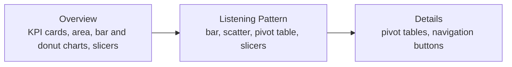

# Spotifyzer: Spotify Listening Dashboard

An interactive Power BI dashboard for exploring Spotify music data: track popularity, audio features (danceability, energy, valence, tempo), artist trends and listening patterns. Data was extracted with the Spotify API before building the report.

## Report structure

`Spotifyzer.pbix` has three pages (read directly from the file):

| Page | Visuals used |
|---|---|
| Overview | Cards, area chart, bar charts, donut chart, slicers, images |
| Listening Pattern | Bar charts, scatter chart, pivot table, slicers |
| Details | Pivot tables and action buttons for navigation |

## What you can explore

- Most popular tracks and artists
- Audio-feature profiles such as danceability, energy, valence and tempo
- How musical attributes change over time
- Filters by year, artist, genre and other categories
- Custom KPIs built with DAX

## Files

| File | Purpose |
|---|---|
| `Spotifyzer.pbix` | The Power BI report |
| `Spotifyzer Dashboard.docx` | Written description of the dashboard |

## Open it

1. Install [Power BI Desktop](https://powerbi.microsoft.com/desktop/) (Windows).
2. Download `Spotifyzer.pbix`.
3. Open it and use the slicers to explore.

## Ideas for next steps

- Live Spotify API refresh
- Recommendations based on audio preferences
- Genre clustering

## Stack

`Power BI` `DAX` `Spotify API`
